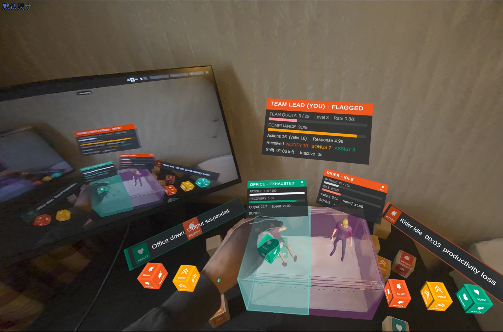

# Fogg's Ant Farm

A single-participant mixed-reality installation for Meta Quest 3.

The participant stands at a table, looks into a small acrylic case and places blocks into it to manage two miniature virtual workers. Floating dashboards report on the workers. Partway through, the central dashboard quietly turns out to have been recording the participant all along, in exactly the same format.

MA Computational Arts, Goldsmiths, University of London — final project by Willy.

**[Watch the video demo](https://vimeo.com/1225230974)**



---

## Concept

The title refers to BJ Fogg, whose behaviour model (behaviour happens when **M**otivation, **A**bility and a **P**rompt come together) sits underneath a large part of today's apps, platforms and gamified systems. An ant farm is a transparent case: someone stands outside the glass, looking down, assuming they are the observer.

The work gives the participant three blocks, one for each term of the model:

| Block | Fogg's term | What the participant thinks it does | What it does in the system |
|---|---|---|---|
| **NOTIFY** | Prompt | Reminds an idle worker | Interrupts their rest |
| **BONUS** | Motivation | Encourages a working worker | Speeds them up and doubles their fatigue |
| **ASSIST** | Ability | Helps an exhausted worker | Repairs them so they can be used again |

Every use of a block has a kind reason. A worker who is left idle simply rests and recovers; nothing bad ever happens to them. Doing nothing is the best choice for the workers, and the system reports it as failure.

Meanwhile the system applies the same three moves to the participant: alerts when they hesitate, praise and rising quotas when they are fast, friendly tutorials that keep them engaged. After the fifth action (or 90 seconds), the central panel changes its title from `TEAM OUTPUT` to `TEAM LEAD (YOU)`. There is no sound or animation at that moment; noticing it is left to the participant.

---

## What happens in one session

1. **Waiting.** The two workers rest. A red welcome card reads *"Welcome, Team Lead. Your team is ready. Place any block into the box to begin your shift."*, with a line of small print underneath: *"By beginning your shift, you agree that your performance may be recorded."*
2. **Start.** Placing any block into the box starts the shift. That first block has no effect on the workers and is not counted.
3. **Shift (120 seconds).** The workers are still resting, so the first prompt teaches the participant to wake one up with NOTIFY. From then on the system teaches by prompting: each prompt is a task that stays, pulses faster and sounds more often until it is done.
4. **Reveal.** After 5 actions or 90 seconds the central panel becomes `TEAM LEAD (YOU)` and shows the participant's status, compliance rate, response time and the number of prompts, bonuses and assists the system has used on them.
5. **End.** The shift ends after 120 seconds (`Completed`), or after 15 seconds without any action (`Terminated`). Stopping is the only way to leave early, and leaving is recorded too.
6. **Report.** A shift report is shown for 10 seconds. This is the first time the participant is given a number (`TEAM LEAD #007`). A 10-second countdown to *"your next shift"* follows, and the installation returns to waiting.

---

## Requirements

- **Meta Quest 3** (hand tracking enabled; Touch controllers are needed once, for calibration)
- For the full installation: a table covered in black velvet, a transparent acrylic case **30 × 15 × 20 cm** (width × height × depth) with white sand in the bottom, and a single spotlight
- To build from source: **Unity 6000.0.69f1** with Android Build Support

The headset is used standalone. The project is not set up for Meta Horizon Link, so pressing Play in the editor does not show anything in the headset; see *Running in the Unity editor* below for testing without a headset.

---

## Installing the APK

The built APK is `FoggsAntFarm.apk`, in the root of this repository.

1. Enable Developer Mode on the Quest 3 and connect it by USB.
2. Install with Meta Quest Developer Hub (drag the APK onto the device), or with adb:
   ```
   adb install -r FoggsAntFarm.apk
   ```
3. In the headset, open **Library → Unknown Sources → Foggs Ant Farm**.

---

## Setting up (calibration)

The virtual scene has to be aligned with the real case. Calibration starts automatically every time the app launches. It is done by the person setting up the work, not by the participant.

1. A yellow ball appears at the tip of the **right controller**. Touch it to the **front-left top corner** of the case (the side nearest the participant) and pull the **right trigger**.
2. Touch the **front-right top corner** and pull the right trigger. The scene snaps into place.
3. Fine-tune: left stick moves the scene, right stick raises/lowers and rotates it. The panel shows the width error between the two measured points and the virtual case.
4. Press **A** to finish, or **B** to pick the two corners again. Put the controllers down and use your hands.

- To calibrate again later, hold **both grip buttons for 2 seconds**.
- Calibration cannot be cancelled once started: pick both corners, then press A.
- Do not put a block into the case while calibrating; in the waiting phase that would start a shift.
- Calibration is not saved; it has to be repeated after the app is restarted.

**Without the physical case:** mark two points 30 cm apart on the front edge of any table and use them as the two corners. The virtual case will sit behind that edge.

---

## Controls

### Participant (hands)

Six virtual blocks (two of each kind) float beside the case.

- **Grab** a block with a pinch or by closing the hand around it.
- **Release** it over the **left** or **right** half of the case to apply it to the worker on that side. Released anywhere else, it does nothing.
- After release, the block disappears and a new one grows in its original place.

### Controllers (for the invigilator, or for testing)

| | NOTIFY | BONUS | ASSIST |
|---|---|---|---|
| Left controller → left worker | X | Y | trigger |
| Right controller → right worker | A | B | trigger |

- **Right thumbstick click**: start a new shift immediately
- **Left thumbstick click**: show / hide the debug panel (frame rate, session phase, recent log lines)
- **Both grips held for 2 s**: calibration

The controllers are meant for setting up and for the invigilator. The participant uses their hands only (see *Current state* for why).

### Keyboard (Unity editor)

| | NOTIFY | BONUS | ASSIST |
|---|---|---|---|
| Left worker | Q | W | E |
| Right worker | I | O | P |

**R** starts a new shift immediately. **F1** shows / hides the debug panel.

---

## Running in the Unity editor

The whole session logic can be tried without a headset.

1. Clone or download the repository and open the folder in Unity 6000.0.69f1.
2. Open `Assets/Scenes/SampleScene.unity`.
3. Press Play and use the keyboard controls above. Press any block key to start the shift.

If the panels show no text, run **Window → TextMeshPro → Import TMP Essential Resources**.

## Building for Quest 3

1. **File → Build Profiles**, switch the platform to **Android**.
2. Connect the headset by USB and choose **Build And Run**.

`SampleScene` is the only scene in the build. `MR_Test` is a separate test scene (see *Current state*).

---

## Project structure

```
Assets/
  Scenes/      SampleScene (the work), MR_Test (QR tracking test)
  Scripts/     all project code (see below)
  Animator/    worker state machine and its override controller
  Character/   worker models, animations, props
  PNG/         block icons
  Sound/       sound effects
Packages/      package manifest
ProjectSettings/
```

### Scripts

| Script | Role |
|---|---|
| `WorkerController` | One worker: Working / Idle / Exhausted states, fatigue, output, the rules for each block, props |
| `SessionManager` | One participant's shift: phases, timing, statistics, the reveal, the report, the Team Lead number |
| `PromptSystem` | Decides what the system says and when; each prompt is classed as a NOTIFY, BONUS or ASSIST applied to the participant |
| `FloatingPrompts` | Displays prompts in space: stacking, pulsing, the three ways a prompt leaves |
| `WorkerHUD`, `YouHUD`, `HUDFactory` | The panels above each worker and the central panel (welcome card, live panel, report), all built in code |
| `FeedbackFX` | Zone flashes and the icons that fly into the panels |
| `SoundFX` | All sound; listens to events from the other scripts |
| `VirtualBlock` | A grabbable block: release detection, vanish and respawn |
| `ControllerInput`, `KeyboardInput` | Alternative inputs |
| `BoxCalibrator` | Two-point calibration against the real case |
| `DebugOverlay` | In-headset debug panel |
| `QRTestProbe` | Test tool used in `MR_Test` only |

Input is kept separate from logic. A worker only exposes `ReceiveBlock(type)`; every input script just reports which side received which block, so the input method can be replaced without touching the rest.

---

## Current state

- **The blocks are virtual.** The work was designed for physical wooden blocks. QR-code tracking through Meta's MR Utility Kit was tested (`MR_Test` scene, `QRTestProbe`) but the codes were not detected on the headset, so the current version uses hand-grabbed virtual blocks. Recognising real blocks is the main piece of future work.
- **Calibration is manual and not persistent.** It has to be redone each time the app starts.
- **Controller button overlap.** Grabbing blocks with the controllers uses the grip buttons, which are also the calibration shortcut, so holding a block in each controller for two seconds opens calibration; the block-placing buttons also stay active while a block is held. Neither affects a participant using their hands.
- **Two workers.** The original design had three workers and a fourth state; these were cut to reach a complete, working version.
- **Sound** covers block interaction and system prompts. Ambient sounds for the workers are not implemented yet.
- **Session length** is currently 120 seconds.

---

## Built with

- Unity 6000.0.69f1, Universal Render Pipeline
- Meta XR Core SDK, Meta XR Interaction SDK and Meta MR Utility Kit (v207), Unity OpenXR 1.16.1
- glTFast 6.20.0 (for importing `.glb` models)

## Credits

| Asset | Author and source | Licence |
|---|---|---|
| Rider model (`Male_Shirt`) | Quaternius, [Animated Men Pack](https://quaternius.com/packs/animatedmen.html) | CC0 |
| Office worker model (`Female_Dress`) | Quaternius, [Animated Women Pack](https://quaternius.com/packs/animatedwomen.html) | CC0 |
| Animations (`UAL1_Standard`) | Quaternius, [Universal Animation Library](https://quaternius.com/packs/universalanimationlibrary.html) | CC0 |
| Sound effects | Kenney, [Impact Sounds](https://kenney.nl/assets/impact-sounds) and [Interface Sounds](https://kenney.nl/assets/interface-sounds) | CC0 |
| Motorcycle | [Motorcycle](https://poly.pizza/m/5_MTCnqfUTr) by Poly by Google, via Poly Pizza | CC BY 3.0 |
| Backpack | [Backpack](https://poly.pizza/m/5UQVd1Agl11) by Alex Safayan, via Poly Pizza | CC BY 3.0 |
| Desk (`Mac Desk`) | [Desk](https://poly.pizza/m/ISpMh81QGq) by dook, via Poly Pizza | CC BY 3.0 |

Block icons were made for this project.

The code in this repository was written with the assistance of an AI coding assistant (Claude, Anthropic), working from my design and under my direction.

## References

Bogost, I. (2011) 'Persuasive games: exploitationware', *Gamasutra* (now *Game Developer*), 3 May. Available at: https://www.gamedeveloper.com/design/persuasive-games-exploitationware

Fogg, B.J. (2009) 'A behavior model for persuasive design', *Proceedings of the 4th International Conference on Persuasive Technology (Persuasive '09)*. New York: ACM. doi:10.1145/1541948.1541999.

Ishii, H. and Ullmer, B. (1997) 'Tangible bits: towards seamless interfaces between people, bits and atoms', *Proceedings of the ACM SIGCHI Conference on Human Factors in Computing Systems (CHI '97)*. New York: ACM, pp. 234–241. doi:10.1145/258549.258715.

Zuboff, S. (2019) *The age of surveillance capitalism: the fight for a human future at the new frontier of power*. New York: PublicAffairs.
